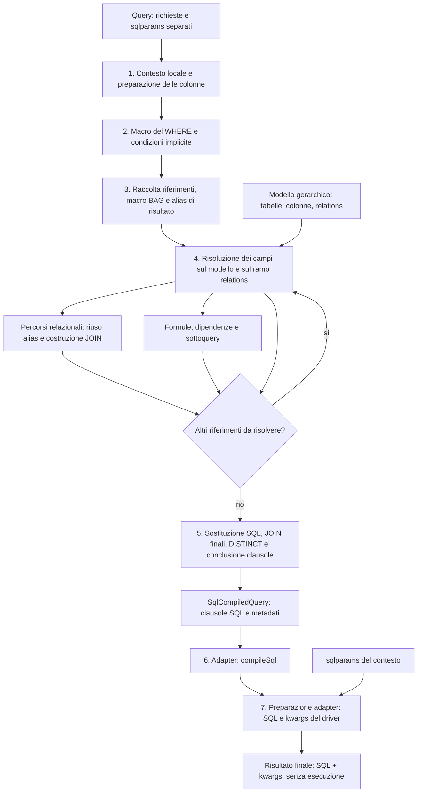

# 86 — Compilatore: fasi legacy e traduzione nel nuovo percorso

**Aggiornamento dopo la replica alla review:** riferimento corrente GenroPy
develop `95da66ee64b0c789dbb6b35254011d83ce1911c5`. Il [censimento 95](95-develop-reference-audit.md)
classifica i 24 commit SQL successivi e fissa i prossimi interventi: prima
#THIS nelle formule, poi binding mancanti; override delle virtuali da decidere
e migration separata. Questa revisione è documentale: codice e oracoli invariati.
I rapporti 88–94 documentano gli incrementi successivi alla fase 2; le fasi
e il diagramma sotto conservano la mappa dell’algoritmo esaminato allora.

15 ottobre 2026. **Fasi 1 e 2 verificate.**
Esito della fase 2 nel [rapporto 88](88-legacy-rewrite-phase2.md).
Contratti, baseline e differenze nel [rapporto 87](87-legacy-rewrite-phase1-baseline.md).
Sostituisce la limitazione
«prima soltanto SELECT fisica, relazioni dopo»: le relazioni fanno parte della
verifica architetturale della sostituzione di QueryPlan/Fragment.

L'obiettivo è riscrivere ordinatamente l'algoritmo legacy sul modello gerarchico,
producendo SQL e kwargs separati, con assemblaggio e preparazione delegati agli
adapter. Si conserva la query pubblica già concordata. Nessuna nuova grammatica,
AST, classe per ogni fase o framework di pipeline.

## Aggiornamento concordato del perimetro — fase 2

Decisione del 15 ottobre 2026, successiva alla baseline 87: per ora si compilano
soltanto le relazioni **verso uno**, anche concatenate e composite. Una direzione
inversa dichiarata `one_one` resta verso uno. Le relazioni verso molti non
producono JOIN: `UnsupportedFeatureError`, con `not yet supported`.
Non si porta lo stato exploding né il DISTINCT automatico che lo accompagnava.
La descrizione del flusso legacy sotto resta una mappa storica, non un requisito
per reintrodurre questi comportamenti.

Si riconosce prima della raccolta dei campi la nuova forma concordata
`@invoices.operazione(argomenti)`. Si risolve il percorso sul ramo relations,
si delimitano parentesi anche annidate e si conservano gli argomenti come testo.
Il dispatcher cerca `getattr(self, 'many_' + operazione, None)`: se manca,
solleva `UnsupportedFeatureError`. **Nessun handler many_* implementato**, neppure
stub. Le firme di sum/calc/first/last, il risultato multiplo e le traduzioni
LATERAL/JSON/XML rimangono da definire; non sono sintassi legacy.

I contratti legacy verso molti restano registrati negli oracoli originali,
ma diventano prove di rifiuto nel percorso nuovo, non xfail da far passare con
righe esplose. I due limiti legacy delle inverse deboli (`@last_invoice` e
`@first_in_invoice`) non sono corretti: ora ricadono nel rifiuto generale verso
molti, prima del vecchio KeyError. Il compilatore precedente resta invariato.

## Obiettivo e vincoli della riscrittura

**Reimplementare nel modo più chiaro e leggibile l'algoritmo legacy,
minimizzando il rischio di divergenze di comportamento. Non introdurre
variazioni non concordate.** Questa è la finalità del lavoro, non un'occasione
per progettare un compilatore diverso.

- Il riferimento normativo corrente è develop `95da66ee64`, con le sole
  divergenze già esplicitamente concordate; il rapporto 95 ne delimita il raccordo. I branch sperimentali sono materiale di confronto,
  non autorizzazioni a sostituirne parti dell'algoritmo.
- Conservare ordine delle operazioni, ricorsione, criteri di riuso delle JOIN,
  assegnazione degli alias e gestione dei parametri. Anche uno spostamento di
  fase apparentemente innocuo deve essere verificato contro il riferimento.
- La pulizia consentita riguarda nomi comprensibili, metodi con responsabilità
  riconoscibili e adattamento all'albero gerarchico esistente. Ogni estrazione
  deve lasciare riconoscibile il blocco legacy e preservarne letture, scritture
  e ordine. Non introdurre gerarchie o astrazioni speculative.
- Riutilizzare gli algoritmi già portati e verificati. Non sostituire regex,
  split e template con scanner, parser o nuove interpretazioni della sintassi.
- Non correggere incidentalmente comportamenti legacy, cambiare default,
  aggiungere validazioni, ottimizzazioni, cache o fallback. Un'anomalia concreta
  va documentata separatamente; non diventa automaticamente lavoro autorizzato.
- Nessuna modifica alla grammatica, ai modelli, al renderer degli oggetti o al
  contratto pubblico della query. SQL e kwargs restano separati; compilare non
  apre connessioni né esegue SQL. RuntimeModel e mixin restano separati.

In caso di impedimento concreto al port fedele, presentare il metodo legacy,
il caso riproducibile e il punto incompatibile con il modello attuale. Non
implementare autonomamente una semantica alternativa. I casi di sintassi
inventati e già esclusi non si ripropongono come decisioni.

## Il flusso reale

La mappa storica sotto è stata ricavata da `fa35e5ad`, `gnrsqldata/compiler.py`, in particolare
`compiledQuery`, `getFieldAlias`, `_findRelationAlias`, `_getRelationAlias` e
`SqlCompiledQuery.get_sqltext`. L'ordine sotto deriva dai corpi dei metodi,
non soltanto dalle docstring. Nel raccordo corrente prevalgono i fix develop
censiti nel rapporto 95, in particolare #THIS prima della raccolta riferimenti
nelle formule. Gli otto snapshot storici sono indicizzati in
[sources.json](evidence/legacy-compiler-phases/sources.json).

Il blocco 4 combina **ricorsione e ciclo di completamento**, come nel legacy.
La ricorsione segue i percorsi relazionali, le dipendenze delle formule e le
sottoquery; il ciclo completa i riferimenti scoperti durante queste operazioni.
Non si sostituiscono questi meccanismi con un nuovo ordinamento delle dipendenze.
Una relazione può introdurre riferimenti nella sua
condizione ON; una formula può richiamare campi e sottoquery. Non si risolvono
prima tutte le colonne per aggiungere le relazioni in un secondo momento.
Le sottoquery rientrano nello stesso algoritmo con il proprio contesto; i
riferimenti correlati continuano a puntare al contesto proprietario.

## Fasi logiche e responsabilità

| Fase | Operazioni da preservare | Stato prodotto |
| --- | --- | --- |
| 1. Contesto e colonne | Inizializzare risultato, alias e stato locale; normalizzare columns; espandere `*`; applicare le regole legacy di aggregazione, ordine di tabella, count e pkey, rispettando le divergenze già concordate | Colonne ancora simboliche; alias principale `t0`; kwargs locali |
| 2. WHERE | Espandere le macro nel loro punto originale; comporre predicato esplicito e filtri del perimetro concordato; parentesi per ciascun elemento di `wherelist` | WHERE simbolico completo |
| 3. Riferimenti e proiezioni | `updateFieldDict` sulle clausole; `embedFieldPars` sul WHERE prima della sua raccolta; espansioni BAG nel punto legacy; separazione colonne, alias espliciti/impliciti, deduplicazione ordinata | `relationDict`, `aliasDict`, proiezioni simboliche |
| 4. Risoluzione | `getFieldAlias` e attraversamento di `relations`; costruire/riusare JOIN; risolvere formule e dipendenze; ripetere fino a esaurire i riferimenti aggiunti | `colPars`, JOIN, alias, parametri locali, informazione sulle righe moltiplicate |
| 5. Conclusione | `templateReplace` sicuro sulle colonne e normale sulle altre clausole; condizioni aggiuntive; sostituzione nelle JOIN; logica DISTINCT/exploding/count; macro finali previste | Clausole SQL risolte nel contenitore |
| 6. Assemblaggio | `SqlCompiledQuery.get_sqltext` delega a `adapter.compileSql`; nessuna rilettura del modello o scansione SQL | Stringa SQL con placeholder nominati |
| 7. Preparazione | Preparazione comune dei valori e adattamento specifico del driver, già raccordati in R3 | SQL e kwargs pronti, ancora separati |

Questa è la mappa del legacy, **non un'autorizzazione a riattivare tutto ciò che
vi si trova**. Restano fuori i comportamenti esplicitamente rinviati: pyColumn
in esecuzione, `#PREF`, table alias, operatori tra query e query concatenate,
oltre agli altri elementi del documento 41. Per virtualRelation valgono le
decisioni della grammatica/GEP: nessuna inverse automatica, order_by/limit o
cardinalità virtuale reintrodotta indirettamente. Le funzioni SQL/macros già
concordate mantengono i rispettivi confini di dialetto.

## Il blocco relazioni, senza un grafo parallelo

Per `getFieldAlias` il modello di partenza è `DbTableObj.relations`, risolto
dal ramo globale `model.relations` già costruito. Si adattano i nomi di accesso
Bag necessari, non si ricrea un elenco alternativo di relazioni dai descrittori
del precedente compilatore.

1. Separare percorso relazionale e campo finale.
2. Per ogni tratto leggere il nodo e il suo `joiner` tramite `_findRelationAlias`.
3. In `_getRelationAlias` cercare prima l'alias già assegnato alla chiave legacy
   composta dal percorso e dall'alias di partenza. Due percorsi verso la stessa
   tabella possono richiedere JOIN diverse.
4. Se manca, assegnare `t1`, `t2`, ecc.; leggere `mode`, `one_relation` e
   `many_relation`, quindi comporre ON e LEFT JOIN secondo il riferimento.
5. Trattare chiavi composte e condizioni delle relazioni verso uno; raccogliere
   gli ulteriori riferimenti dell'ON. Rifiutare verso molti prima di allocare JOIN.
6. Non registrare righe moltiplicate né aggiungere DISTINCT implicito.

Caso concreto del modello nativo: `invc.invoice` → `@customer_id.account_name`.
Lo stesso percorso in columns, WHERE e order_by deve usare la medesima JOIN.
Le inverse `customer.@invoices` sono prove di rifiuto esplicito; i percorsi
concatenati verso uno sono prove di equivalenza al legacy.

## Cosa riprendere dai branch sperimentali

| Riferimento | Organizzazione utile | Comportamenti da non importare automaticamente |
| --- | --- | --- |
| v2 `68f35b9` | Distinzione fra risoluzione di colonna e gestione alias; chiave di riuso basata su percorso e alias di partenza | Non basta estrarre `ColumnCompiler` se ricopia stato sul compilatore; niente aggregazione automatica dei percorsi many |
| v3 / merged / v4 `67bba0e`, `19da337`, `38d210c` | Separazione fra trattamento formula, preprocessing e compilazione della sottoquery; clausole conservate fino all'assemblaggio | Niente conversione automatica sottoquery→JOIN, condensazione per hash o nuove firme `join_to/join_from` |
| simplify `13b8918` | Accesso alle virtuali attraverso un modello relazionale completo; utile per verificare il raccordo al nuovo albero | Non assumere che la copia `compiler_new` sia un algoritmo già corretto o completo |
| next `12cfdcc` | Percorso alternativo confrontabile con l'originale | Non attribuirgli miglioramenti algoritmici: i corpi erano ancora equivalenti al riferimento |
| compound `4c075f7` | Riferimento per proprietà dei parametri e riuso delle query, già esaminato nel piano 56 | Non riaprire in questo passo UNION/intersezione/differenza o query concatenate |

Esempio concreto della cautela necessaria: in v4 `_handleFormulaColumn` estrae
`var_*` prima di invocare il metodo della formula; il riferimento invoca il
metodo prima, consentendogli di modificare gli attributi. Si mantiene l'ordine
legacy. I prefissi basati su `id(fldalias)` e la modifica degli attributi del
modello non diventano requisiti del port. Separare un metodo è pulizia del
codice; cambiare il risultato della query è un'altra decisione.

## Traduzione in codice proposta

**Un compilatore, un contenitore delle clausole, gli adapter esistenti.**

- `TreeQueryCompiler` diventa l'orchestratore del flusso legacy sul nuovo
  modello, senza dipendere da `_SelectCompiler`, `_Context`, QueryPlan o Fragment
  del percorso precedente. Le fasi sono gruppi di metodi privati; non classi
  intercambiabili né una nuova API di pipeline.
- Un contenitore equivalente a `SqlCompiledQuery` conserva `maintable`,
  `maintable_as`, `columns`, `joins`, `where`, `group_by`, `having`, `order_by`,
  `distinct`, `limit`, `offset`, `for_update` e i metadati effettivamente usati.
  Clausole stringa e JOIN lista di stringhe, come nel legacy. Le strutture
  `relationDict` e `aliasDict` seguono il ruolo originale; niente stato exploding;
  i campi dei sottosistemi rinviati non richiedono implementazioni anticipate.
- `sqlparams` rimane separato, nel contesto della compilazione. Nessuno stato
  SQL viene scritto sul modello condiviso. La query riutilizzata deve compilarsi
  nuovamente senza contaminazione di alias o parametri.
- `_legacy_sql.py` conserva gli algoritmi già portati e verificati: non si
  riscrivono di nuovo regex, split, template, alias ed embedFieldPars.
- `getFieldAlias`, `_findRelationAlias`, `_getRelationAlias`, `getJoinCondition`
  conservano responsabilità e ordine del legacy. Formula e sottoquery possono
  avere helper separati nei punti mostrati dai branch, rispettando il contesto
  proprietario e il raccordo RuntimeModel già esistente.
- Alias delle tabelle e mangler dei parametri restano distinti. Ogni sottoquery
  possiede il suo contesto; la composizione SQL/kwargs avviene prima dell'unica
  preparazione finale del driver. Si preservano i contratti di isolamento già
  verificati, senza importarvi le collisioni dell'espansione collection né
  correggere tale espansione come effetto collaterale.
- L'adapter assembla direttamente le clausole del contenitore. Il nuovo percorso
  non le trasforma in QueryPlan per riusare il vecchio renderer e non produce
  SqlStatement come passaggio intermedio. Il `CompiledQuery` pubblico finale,
  con SQL, params e metadati del risultato, resta il contratto d'uscita.

## Corrispondenza da mantenere nel codice

Questa tabella indica responsabilità già presenti nel legacy, non nuove API.
Nell'implementazione registrare per ogni blocco il metodo originale e il metodo
di destinazione effettivo, insieme ai test che lo confrontano.

| Origine legacy | Destinazione nel nuovo percorso | Vincolo |
| --- | --- | --- |
| `compiledQuery` | Orchestrazione in `TreeQueryCompiler` | Stesso ordine delle fasi; helper privati solo per rendere leggibili blocchi riconoscibili |
| `SqlCompiledQuery` / `get_sqltext` | Contenitore equivalente e delega all'adapter | Clausole stringa, JOIN ordinate, metadati necessari; kwargs separati |
| `updateFieldDict`, `embedFieldPars`, split e template | Algoritmi già portati in `_legacy_sql.py` | Riuso e verifica delle chiamate nel punto originale |
| `getFieldAlias` | Risoluzione ricorsiva sul nuovo albero | Campi fisici, alias e formule nello stesso ordine del riferimento |
| `_findRelationAlias`, `_getRelationAlias`, `getJoinCondition` | Navigazione del ramo `relations` e costruzione JOIN | Stesse chiavi di riuso, contesti, direzioni e tracciamento delle righe moltiplicate |
| Rami formula e sottoquery di `getFieldAlias` | Helper locali del compilatore | Stesso ordine metodo → attributi risultanti → `var_*` e sottoquery; conservare la correlazione |
| `adapter.compileSql` e preparazione driver | Adapter esistenti raccordati al contenitore | Nessuna risoluzione del modello nell'adapter; preparazione separata dall'esecuzione |

## Ordine di realizzazione e prove di chiusura

**Stato: fasi 1 e 2 completate, fasi 3–5 da eseguire.** Il rapporto 87 registra
144 test originali passati e 2 skip, 62 replay dei contratti legacy passati,
148 SELECT fisiche equivalenti e il confronto di tutte le 144 relazioni native.
Sul nuovo albero 4 contratti mirati passano e 58 restano xfail stretti:
la baseline non certifica le funzionalità ancora da portare. I test R1–R4 già
verdi sono materiale riutilizzabile, non prova che questa riscrittura sia completata.
L'ordine sotto è l'ordine del lavoro: non cambia l'ordine di esecuzione del
compilatore descritto nel diagramma.

### 1. Fissare il riferimento e i confronti

**Completata:** [rapporto e differenze 87](87-legacy-rewrite-phase1-baseline.md).
Il compilatore è invariato; le differenze vengono esposte prima della fase 2.

Selezionare i test originali e le richieste reali di `test_invoice_pg` già
censiti, includendo relazioni dalla prima batteria. Riusare oracoli e fixture
esistenti dopo averne verificato provenienza e perimetro. Per ogni caso annotare
snapshot/metodo/test di origine e adattamenti necessari della fixture.

**Consegna:** matrice delle funzionalità ammesse, test di riferimento e lista
separata delle divergenze già concordate, con rimando alla decisione. Fissare SQL,
kwargs, JOIN, alias, metadati e risultati quando l'esecuzione è applicabile.

**Chiusura:** baseline eseguita sul riferimento; eventuali fallimenti o limiti
dell'ambiente esplicitati. Nessun risultato Asqueel usato da solo come oracolo.
Non includere sintassi inventate o funzionalità rinviate per allargare il lavoro.

### 2. Contenitore, relazioni verso uno e riconoscimento delle operazioni a molti

**Completata:** [rapporto e contratti 88](88-legacy-rewrite-phase2.md).

Introdurre `SqlCompiledQuery` e l'assemblaggio degli adapter. Portare campi
fisici, aliasColumn semplici e relazioni verso uno, composite e concatenate,
leggendo il ramo `relations`. Preservare ordine, chiavi di riuso e alias legacy.
Eliminare dal nuovo percorso QueryPlan/Fragment e l'ereditarietà dal precedente.

Riconoscere le chiamate sulle relazioni a molti e cercare il relativo `many_*`
con getattr; nessun handler iniziale. Nessun port di exploding/DISTINCT/count
relazionale. Le altre clausole non già supportate restano alla fase 4.

**Chiusura:** equivalenza SQL/kwargs per le relazioni verso uno dei 74 modelli;
JOIN riusate fra clausole, più percorsi verso la stessa tabella, almeno due livelli,
chiavi composte, ON con riferimenti. Verificare rifiuto delle relazioni a molti e
riconoscimento di operazione/argomenti senza risolverli nel contesto sbagliato.
Niente I/O durante la compilazione; prove di esecuzione separate, modello e JSON
migration invariati. Il vecchio compilatore rimane disponibile senza fallback.

### 3. Completare la ricorsione di formule e sottoquery

**Completata:** [rapporto e verifiche 89](89-legacy-rewrite-phase3.md).

Portare formule SQL, aliasColumn, formule da metodo, `var_*`, select/exists/select_*,
subQueryColumn e riferimenti ai metodi subquery_* già concordati. Conservare il
raccordo RuntimeModel esistente. Le formule aggiungono dipendenze allo stesso
meccanismo legacy; le sottoquery ricompilano con il proprio contesto e mantengono
i riferimenti al contesto esterno. Alias e mangler hanno responsabilità distinte.

**Consegna:** i rami ricorsivi del riferimento, con helper leggibili e tracciati
alla loro origine. Nessuna conversione automatica di sottoquery in JOIN.

**Chiusura:** relativi test legacy e dei branch confrontati con il riferimento;
formule che introducono altre formule o JOIN; sottoquery correlate e sorelle con
parametri omonimi; ricompilazione della stessa query senza contaminazione.
Modello condiviso invariato dopo la compilazione e preparazione del driver
effettuata soltanto alla composizione finale.

### 4. Completare le clausole e le interazioni già previste

**Raccordo verificato:** [rapporto 90](90-legacy-rewrite-phase4.md). Correzione
esistente IN_RANGE/NULL PostgreSQL riusata con approvazione esplicita. Pkey automatica
ora opt-in con `addPkeyColumn=True`, default False nel nuovo percorso.

Il count è ora raccordato a livello di compilatore: [rapporto 91](91-legacy-tree-count.md).
Fetch e count sono raccordati anche come terminali di esecuzione sul nuovo albero:
[rapporto 92](92-hierarchical-fetch-count.md). Per decisione del 15 ottobre,
restano soltanto `*` e le colonne esplicite; i wildcard avanzati sono esclusi
dalla TODO e registrati fra le [cose non portate, R-11](41-deferred-features.md#r-11--wildcard-avanzati).
Le operazioni verso molti restano senza handler per decisione esplicita; non si
certificano quindi interazioni con righe esplose o DISTINCT implicito. L'ordine
di `*` riflette l'albero nativo: la precedenza delle options nel renderer ha
risolto i due contratti `star`, senza modifiche al compilatore. Il
[rapporto 93](93-options-first-object-renderer.md) registra il confronto sui 74
modelli e le 12 differenze d’ordine, successivamente accettate dall’utente.
Il [rapporto 94](94-shared-option-fields.md) verifica invece la composizione
dei campi condivisi, senza modificare espansioni o compilatore.

Raccordare options, filtri impliciti, espansione di `*`, bagItemColumn, macro,
raggruppamenti e clausole rimanenti nel perimetro approvato. Collocare ogni
operazione nel punto originale del flusso, non semplicemente in coda al port.
Non reintrodurre comportamenti rinviati incontrandoli nel codice legacy.

**Consegna:** flusso completo del perimetro concordato, inclusi metadati già
richiesti dal contratto pubblico del risultato.

**Chiusura:** test originali pertinenti e verifiche delle interazioni fra inverse,
filtri, formule, DISTINCT, count, group_by/having, ordinamento e limiti. Preservare
le differenze fra dialetti previste dagli adapter e i mapping già decisi per le
options. Non modificare le query di prova per nascondere differenze.

### 5. Verificare insieme comportamento e leggibilità

Confrontare il nuovo percorso con il legacy sui casi validi reali e su tutti i
74 modelli nativi, attraversando tutti i package di `test_invoice_pg`. Le SELECT
fisiche già disponibili sono solo una parte della copertura: includere relazioni,
formule e sottoquery effettivamente presenti. Eseguire la regressione del percorso
precedente e delle scritture che condividono gli adapter. Eseguire separatamente
le prove SQL su SQLite/PostgreSQL; verificare modello e JSON migration invariati.

**Consegna:** rapporto per funzionalità con test passati, falliti e non eseguiti,
differenze motivate dal contratto già concordato e punti ancora incompleti.
Misurare i carichi reali e i riferimenti ripetuti come controllo di regressione:
le misure non autorizzano ottimizzazioni algoritmiche.

**Chiusura:** nessuna differenza di comportamento non concordata nei confronti
del perimetro; nessun caso mancante presentato come coperto. Revisione del codice
affiancata al legacy: flusso riconoscibile, stato di ciascuna compilazione chiaro,
nessuna duplicazione del ramo relations, nessuna astrazione o sintassi aggiunta.
Il passaggio definitivo al nuovo percorso richiede questa verifica; il percorso
precedente non viene rimosso incidentalmente durante il port.

Prove imprescindibili: stessa relazione in più clausole senza JOIN duplicate;
due relazioni distinte verso la stessa tabella; almeno due livelli di percorso;
rifiuto delle inverse verso molti; formula con relazione; condizioni ON che introducono
riferimenti; query ricompilata e sottoquery sorelle con parametri omonimi.
I test originali sulle inverse e quelli sulle formule dei branch sono punto di
partenza; eventuali adattamenti di fixture vanno esplicitati. L'assenza di
QueryPlan/Fragment va verificata anche impedendo l'accesso a quei componenti
durante la compilazione del nuovo percorso.

**Criterio complessivo:** algoritmo legacy riconoscibile e leggibile, con
relazioni e ricorsione verificate; nessuna divergenza non concordata nel perimetro
portato. Un test verde non giustifica una modifica dell'algoritmo. La semplicità
cercata viene dall'ordine del legacy e dalla rimozione dei passaggi ridondanti.

## Decisioni che aggiornano i documenti precedenti

- Il parametro scritto tra apici è un errore d'uso per il contratto concordato.
  La proposta ClientCursor del rapporto 85 è ritirata; il binding attuale resta.
  Quel caso storico non blocca l'accettazione. La collisione IN documentata in
  R3 resta distinta e non viene corretta in questo lavoro.
- La richiesta successiva include le relazioni nell'obiettivo: la vecchia
  sequenza «prima sostituire i contenitori, poi valutare le relazioni» è superata.
- La fase 1 aggiunge contratti e prove, senza modificare compilatore, modelli,
  driver o sintassi. Le funzionalità mancanti non sono dichiarate implementate.
