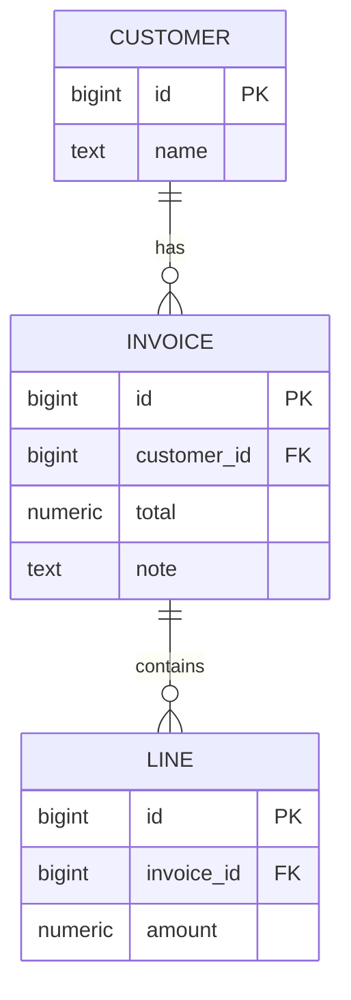

# Tutorial: customers, invoices and computed columns

Build a small application using configuration, live tables, relations,
correlated formulas and aggregations. Then create the tables, insert data, read
it back, commit a change, verify a rollback and delete a row. Fetched rows
support access by name and position; `dict(row)` gives a dictionary.

The same script runs on SQLite and on PostgreSQL. You need Python and
`asqueel[migration]`; for PostgreSQL also `asqueel[postgresql]` and a reachable
**test database** whose role can create schemas. Nothing installs or starts
PostgreSQL automatically.

Download {download}`shop_tutorial.py <_examples/shop_tutorial.py>`. Without
`ASQUEEL_DSN` it runs on a SQLite file in a temporary directory:

```sh
python shop_tutorial.py
```

With `ASQUEEL_DSN` it runs on PostgreSQL, in a uniquely named schema that its
cleanup block removes; an interrupted process may leave that schema:

```sh
export ASQUEEL_DSN="host=localhost dbname=example user=example"
python shop_tutorial.py
```

The sections below show extracts from that same file, in order. Download the
complete script to run it without assembling fragments. Its assertions check
both returned values and transaction behavior.

## 1. Describe the application model

A customer has invoices; an invoice has lines. The relations are declared on
the invoice (to its customer) and on the line (to its invoice). Each relation
also names its inverse, `invoices` and `lines`, which a query uses to aggregate
the related rows from the other side.



Import the public application interfaces and standard Python value types:

:::{literalinclude} _examples/shop_tutorial.py
:language: python
:start-after: "# imports-start"
:end-before: "# imports-end"
:::

Define the model in a recipe. `main()` creates the schema and calls one method
per table. Each method defines that table's columns, relations and formulas,
reusing its `columns()` and `virtual_columns()` handles:

:::{literalinclude} _examples/shop_tutorial.py
:language: python
:start-after: "# model-start"
:end-before: "# model-end"
:::

Notice the three kinds of invoice column definitions:

| Column | Definition | Stored in the database? |
|---|---|---|
| `total` | Ordinary numeric column. | Yes |
| `double_total` | SQL expression over a local column. | No |
| `line_total`, `has_lines` | Scalar SUM and EXISTS correlated with this invoice. | No |

`#THIS.id` refers to the invoice that owns the formula. `$invoice_id` and
`$amount` refer to the line being examined inside the subquery. An invoice with
no lines has `line_total=None` and `has_lines=False`: SUM over an empty set is
NULL. Use a named subquery and `COALESCE` when the desired result is zero; see
[formulas](formulas.md).

This example supplies its own integer keys. An insert with an empty integer
key would get `max(id)+1` (see [writes](writes.md)). Nothing keeps the stored
total synchronized with the lines: the total and the calculated sum are
separate values by design.

## 2. Add deployment configuration and render

Keep the schema and connection choice outside the reusable application recipe.
`open_shop()` targets PostgreSQL; `open_sqlite_shop()` targets a SQLite file:

:::{literalinclude} _examples/shop_tutorial.py
:language: python
:start-after: "# deployment-start"
:end-before: "# deployment-end"
:::

The deployment has the same root label, `shop`. Its connection and physical
schema override the parent configuration without discarding the parent's tables.
Application code still uses `sales.invoice`; the actual PostgreSQL schema has a
unique generated name. This is the same mechanism you can use to target a test
or production schema. [Configuration](configuration.md) explains the read stack.

Both functions return a live database without connecting. It has already resolved
the model, so invalid declarations can fail here.

## 3. Create the tables

Rendering the model does not create database objects. `db.migrate()` compares
the model with the live database and applies the DDL that is missing: here the
schema and the three tables, with their keys and foreign keys. It needs the
`asqueel[migration]` extra:

:::{literalinclude} _examples/shop_tutorial.py
:language: python
:start-after: "# setup-start"
:end-before: "# setup-end"
:::

All application values in the following steps go through value mappings or
query parameters. For maintained application schemas, read [migrations](migrations.md).
The [quickstart](quickstart.md) shows a setup with hand-written DDL, without the
migration extra.

## 4. Insert related rows in one transaction

:::{literalinclude} _examples/shop_tutorial.py
:language: python
:start-after: "# seed-start"
:end-before: "# seed-end"
:::

The customer rows are inserted before invoices, and invoices before lines, to
satisfy their foreign keys. All writes share an implicit transaction. The explicit `db.commit()` commits
all of them; an error rolls the unit of work back. `Decimal` represents the
amounts without introducing binary floating-point rounding.

## 5. Read through relations and correlated formulas

:::{literalinclude} _examples/shop_tutorial.py
:language: python
:start-after: "# reads-start"
:end-before: "# reads-end"
:::

`read_invoices()` returns two rows, one per invoice. The two lines of invoice
10 do not multiply its outer result: their SUM is a scalar subquery. `@customer_id.name`
follows the declared relation and generates a join to the customer, without
requiring an `aliasColumn` in the model. `AS customer_name` names the result
field. No Python row aggregation is involved.

An `aliasColumn` is useful when a deeper relation path or a frequently reused
path deserves a name in the model. For this direct relation, the query can use
`@customer_id.name` as it is.

`read_customers()` reads from the other side of the relation:
`@invoices.aggr(count() AS invoices, sum($total) AS amount)` counts and sums
the invoices of each customer, one row per customer. The aggregation is a
correlated subquery too; [queries](queries.md#aggregate-related-rows-with-aggr)
lists the functions.

`query.sqltext` compiles without executing. `.fetch()` executes within the
transaction and returns mutable `NamedList` rows. For binding, filtering and pagination,
continue with [queries](queries.md).

## 6. Save a change, cancel another, delete a row

:::{literalinclude} _examples/shop_tutorial.py
:language: python
:start-after: "# changes-start"
:end-before: "# changes-end"
:::

`update()` takes the key of the changed row from `old_record`, then `pkey`, then
the record itself, and returns the record it received.
`query(...).fetchRecord()` loads exactly one visible row. The second
update is rolled back by `db.rollback()` in the exception handler. The
read after it confirms that the previously committed name remains.

`remove_line()` deletes line 101. `delete()` accepts a key or a record; this
record holds only the key, so the table reads the full row with a lock before
running the delete cycle. The invoice's `line_total` then drops to 100.00.

SQL execution errors automatically roll back the selected connection. A Python
exception requires explicit rollback, as above. Named connections and deferred
callbacks are described in the transaction guide.

## 7. Own the lifecycle and clean up

:::{literalinclude} _examples/shop_tutorial.py
:language: python
:start-after: "# run-start"
:end-before: "# run-end"
:::

The outer database context owns closing; the example explicitly commits or
rolls back each unit of work. On PostgreSQL, cleanup first clears any pending
transaction and then removes only the generated schema. On SQLite, the temporary
directory and its database file are removed. After the printed rows, the script
reports:

```text
Tutorial completed; committed writes and rollback verified.
```

## Where to go next

- Add UI metadata, physical naming and shared model helpers: [models](models.md).
- Implement business rules using table subclasses: [hooks](hooks.md).
- Introduce a current organization, drafts and logical deletion: [row policies](row-policies.md).
- Check differences before porting existing code: [legacy compatibility](legacy.md).
