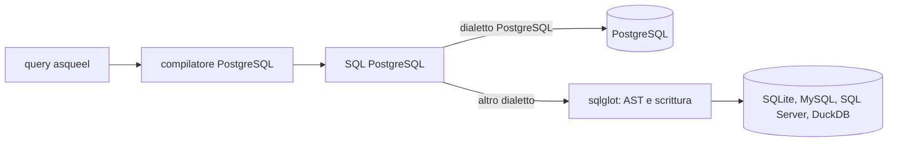

<!-- generated from sqlglot-transpilation.xml by xmldocs: do not edit, edit the XML -->

## Traduzione dei dialetti con sqlglot
*Proposal · proposal/sqlglot-transpilation · 2026-10-20 · draft*

### Problem

Ogni dialetto SQL richiede un compilatore o una logica di dialetto propria. Ogni dialetto nuovo moltiplica il codice da scrivere e da testare.

sqlglot è una libreria Python con licenza MIT. Legge SQL di un dialetto, costruisce un AST e scrive lo stesso AST in un altro dialetto. Questo documento propone di usarla per i dialetti diversi da PostgreSQL.

### Current state

#### GenroPy

Fonte: il ramo `origin/develop` della repo genropy al commit `5c72f3fbd7` del 2026-10-19.

- `READ` `gnrpy/gnr/sql/adapters/` · 2026-10-20 — GenroPy ha un adapter per dialetto: PostgreSQL, SQLite, MySQL, SQL Server. Ogni adapter scrive il proprio SQL per le differenze di dialetto.

#### Prova precedente

Una prova fatta con sqlglot 30.22.0 sul dialetto postgres ha letto SQL già compilato e ne ha visitato l'AST. Ha distinto SELECT ammesse e statement rifiutati in otto casi. La prova non ha tradotto SQL tra dialetti.

### Proposed solution

asqueel compila solo SQL PostgreSQL. Per un altro dialetto, sqlglot legge l'SQL PostgreSQL e lo scrive nel dialetto di destinazione.

*Percorso di una query verso un dialetto diverso da PostgreSQL*

#### Vantaggi

- Un solo compilatore da scrivere e da testare.
- La logica di dialetto è nel codice di sqlglot.
- Altri dialetti diventano possibili: MySQL, SQL Server, DuckDB.

#### Limiti da verificare

- Semantica che non si traduce. `FOR UPDATE` non esiste su SQLite. `jsonb_agg`, `xmlagg` e `tsvector` non hanno un equivalente in ogni dialetto. Queste funzioni restano capability del dialetto e sono rifiutate prima della traduzione.
- Conservazione dei parametri. I segnaposto dei parametri devono arrivare intatti nell'SQL tradotto, con lo stile del driver di destinazione.
- Costo di analisi. Leggere e riscrivere ogni statement ha un costo. Una cache dell'SQL tradotto lo limita.
- Nuova dipendenza. sqlglot entra tra le dipendenze del pacchetto, con i suoi rilasci.

#### Primo passo

Una prova traduce in SQLite l'SQL generato dai test PostgreSQL. Esegue l'SQL tradotto su SQLite e conta quanti test passano. Il conteggio dice quanta parte del compilatore SQLite la traduzione può sostituire.

- **must** — Questa proposta non aggiunge codice né dipendenze. La decisione arriva dopo la prova.
- **must** — Una funzione che sqlglot non traduce resta una capability del dialetto e solleva l'errore che la nomina.

### Decisions

- **dn-sqlglot-trial** `open` — Si fa la prova di traduzione dei test PostgreSQL in SQLite?
   1. **Sì, prima di altri dialetti**: La prova misura la parte di SQL tradotta correttamente. Il risultato decide se sqlglot sostituisce i compilatori di dialetto.
   2. **No, un compilatore per dialetto**: Ogni dialetto ha la propria logica, come gli adapter GenroPy.

### Consequences

Se la prova riesce, ogni dialetto nuovo richiede la sua dichiarazione delle capability e i test, non un compilatore.

Se la prova fallisce su molti casi, la traduzione resta limitata o si abbandona. Il catalogo delle capability serve in entrambi i casi.

### Related documents

- `proposal/capability-catalogue` — Catalogo delle capability dei dialetti
